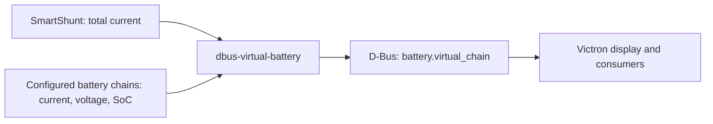

# Virtual battery architecture

`dbus-virtual-battery` reads an existing SmartShunt and the configured battery
chains over D-Bus. It subtracts the measured chain currents from the SmartShunt's
total current to estimate the remaining chain. Voltage and state of charge are
derived from the configured chains. The service publishes the result as
`com.victronenergy.battery.virtual_chain`.

The default required chains are `mqtt_chain1` and `mqtt_chain2`. The separate
`dbus-mqtt-battery` driver supplies those measurements; this service does not
subscribe to MQTT or install the chain drivers. Configure the full required
chain list before installation. Missing sources remain required after startup.

The virtual battery stays unavailable until the SmartShunt and every required
chain are connected and have valid measurements. MQTT sources also need the
driver's complete, fresh snapshot metadata. A missing or stale chain is never
treated as zero current. Derived measurements do not establish physical BMS
charge or discharge permission.

## Operation and further reading

SetupHelper installs the supervisor as `dbus-virtual-chain`, with logs under
`/var/log/dbus-virtual-chain`. Use the project's own installation and monitoring
instructions when diagnosing this service:

- [Configuration and source freshness](../../README.md#configuration-notes)
- [Installation](../../README.md#installation)
- [Monitoring](../../README.md#monitoring)
- [Security boundaries and source validation](../../docs/security-assurance.md)
